# stick-s3

**StickMirror**: wireless screen-mirror firmware for the M5StickC S3, built with PlatformIO. It's the StickS3 sibling of [cardputer-adv-mirror](https://github.com/m5stack-lab/cardputer-adv-mirror) and [tab5-mirror](https://github.com/m5stack-lab/tab5-mirror).

The firmware hasn't been pushed to this repo yet.

<!-- org-footer -->
---

Part of <a href="https://github.com/m5stack-lab">m5stack-lab</a> · unofficial M5Stack projects, not affiliated with M5Stack · built by <a href="https://github.com/ry-ops">ry-ops</a>

